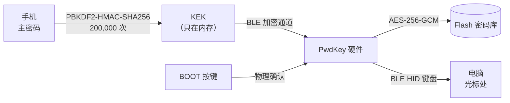
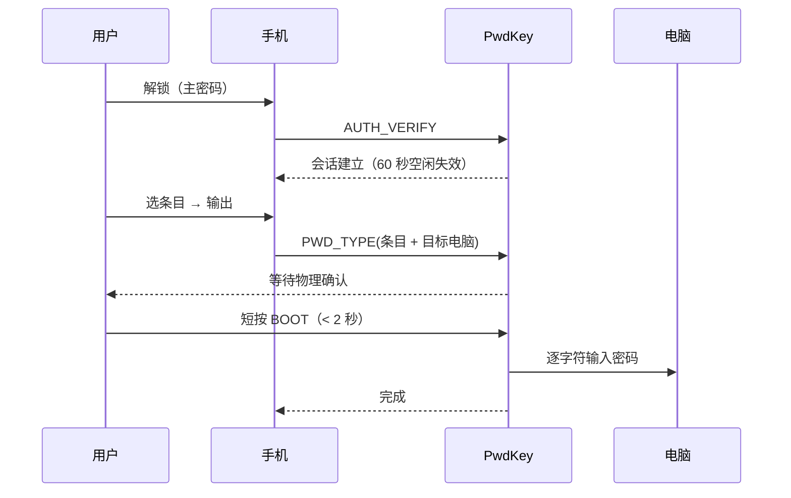

# PwdKey

> 把密码库装进硬件，用硬件当键盘把密码"打"进电脑。
>
> 电脑侧不经过剪贴板、不装任何软件、不留明文副本。

[](LICENSE)
[](pwdkey/)
[](PwdKey_固件操作部署手册_v1.0.md)

<sub>[English summary ↓](#english)</sub>

---

## 为什么做这个

主流密码管理器的薄弱点不在"加密"，而在**密码离开保险库之后的那一段路**：

- 复制密码 → 经过**剪贴板**（剪贴板历史、输入法云同步、其他 App 都能读）
- 浏览器插件自动填充 → 插件本身拥有读取页面的权限
- 手机输入法 → 部分输入法会上传输入内容

PwdKey 换了条路：密码**加密存在一个 U 盘大小的硬件里**，需要时由硬件**模拟一个蓝牙键盘**，把密码逐字符"敲"进当前光标位置。

对电脑来说，这就是一个普通蓝牙键盘在打字。没有剪贴板、没有插件、没有驱动、没有明文经过操作系统。

## 它怎么工作



每次输出都要过三道关：



**为什么要有物理确认**：即使手机被远程控制、或者 App 被替换，攻击者也必须在物理上碰到这台设备才能把密码打出去。这是远程攻击者跨不过去的一步。

## 特性

- **硬件加密存储** — AES-256-GCM，密钥由主密码派生，永不写入 Flash 明文
- **免驱键盘输出** — 标准 BLE HID，Windows / macOS / Linux / Android / iOS 都能用
- **物理按键确认** — 每次输出必须在设备上按一下
- **主密码不留存** — 设备只保存 `HMAC(KEK, ...)` 验证值，改不了、读不出、找不回
- **渐进式锁定** — 输错 3 次锁 30 秒 / 6 次锁 5 分钟 / 10 次永久锁定
- **多电脑管理** — 每台电脑有独立名字（用户自定义 > 自动读取的蓝牙名 > MAC 兜底）
- **三端可管** — 微信小程序 / 独立安卓 App / 命令行工具
- **安卓 App 完全离线** — APK **没有申请 `INTERNET` 权限**，系统层面就无法联网
- **审计日志** — 输出、认证失败、锁定等事件写入独立分区

## 硬件

| 项 | 规格 |
|---|---|
| MCU | ESP32-S3（N16R8：16 MB Flash + 8 MB PSRAM） |
| 按键 | 1 个 BOOT 键（确认 / 取消 / 工厂重置） |
| 供电 | USB |
| 蓝牙 | BLE 5.0，同时支持 3 条链路 |

成本约 ¥30–40（开发板方案，无需打板）。

## 仓库结构

```
pwdkey/                 ESP-IDF 固件（C）
  main/                   BLE HID、管理服务、加密存储、会话、审计
pwdkey_app/             微信小程序（原生 WXML/WXSS/JS）
pwdkey_android/         安卓 App（Capacitor + Web 前端 + 原生 BLE 桥）
  www/src/               前端源码（含从小程序复用的协议与加密层）
  tests/                 加密等价性对拍 + jsdom 全链路冒烟
tests/miniprogram/      协议 / 加密 / 业务流程测试（Node）
PwdKey_使用手册_v1.0.md              给使用者
PwdKey_小程序使用指南_v1.0.md         微信版说明
PwdKey_安卓App使用与构建手册_v1.0.md   安卓版说明
PwdKey_固件操作部署手册_v1.0.md        烧录 / 协议 / 勘误
ESP32-S3_BLE密码输入器_项目开发总纲_v1.1.md   设计依据
```

## 快速开始

### 1. 烧固件

```bash
# 需要 ESP-IDF v5.5.x
cd pwdkey
idf.py set-target esp32s3
idf.py build
idf.py -p /dev/ttyACM0 flash      # Windows: -p COM6
```

> 构建配置里两项关键设置（见 `sdkconfig.defaults`）：
> `CONFIG_BT_NIMBLE_ROLE_CENTRAL=y`（读对方蓝牙名需要 GATT Client）、
> `CONFIG_BT_NIMBLE_MEM_ALLOC_MODE_EXTERNAL=y`（PSRAM 放蓝牙缓冲）。

### 2. 装管理端（任选其一）

| 方式 | 获取 |
|---|---|
| **安卓 App**（推荐，离线） | 到 [Releases](../../releases) 下载 APK 直接安装 |
| 微信小程序 | 用微信开发者工具导入 `pwdkey_app/`，自行编译预览 |
| 命令行 | `pip install bleak pyserial` 后跑 `pwdkey_cli.py` |

### 3. 首次启用

```
连接设备（默认广播名 PwdKey-XXXX，持续 120 秒）
→ 设置主密码（≥ 8 位，纯 ASCII）
→ 在设备上短按 BOOT
→ 抄下 24 位恢复码（只显示这一次）
```

### 4. 让电脑把它当键盘

```
App → 密码库 → 配对新电脑 → 设备上按 BOOT
→ 到电脑的「蓝牙设置 → 添加设备」选择 PwdKey
```

之后每次输出密码，都要先让电脑的光标停在目标输入框里。

## 安全模型

### 能防住的

| 威胁 | 为什么 |
|---|---|
| 剪贴板泄露 / 剪贴板历史 | 密码从不进剪贴板 |
| 浏览器插件读密码库 | 没有插件，密码不经过浏览器 |
| 输入法上传输入内容 | 走 HID 键盘，不经过手机输入法 |
| 电脑上的密码文件被翻 | 电脑侧不存任何密码 |
| 手机 App 被替换 / 被远程控制 | 输出前必须**物理按键确认** |
| 设备丢失 | 密码库用主密码派生的密钥加密，没主密码打不开 |
| 有人捡到设备暴力试密码 | 3/6/10 次渐进锁定，第 10 次永久锁定 |

### 防不住的（重要，请务必读完）

| 威胁 | 说明 |
|---|---|
| **主密码太弱** | 攻击者拆机读出 Flash 后可**离线爆破**。主密码强度 = 全部安全。请用 12 位以上混合字符。 |
| **内核级键盘记录器** | HID 键盘输入本质上是按键事件，内核层记录器照样能看到。这是所有硬件键盘方案的共同上限。 |
| **摄像头 / 肩窥** | 密码会显示在屏幕上。 |
| **刷了别人的固件** | 固件是开源的，你可以自己审；但如果你烧了来源不明的固件，一切保证失效。 |
| **物理拆解 + 侧信道** | 没有做防拆封装、没有做侧信道防护。这是开发板方案，不是金融级安全芯片。 |

> 一句话定位：**它防的是"远程"和"软件层面"的窃取，不是防 NSA。**

## 协议概览

管理服务 `0xFFF0`，命令特征 `0xFFF3`（写），响应特征 `0xFFF4`（通知/读）。

```
帧格式: A5 | VER | OPCODE | FLAGS | LEN(LE16) | TLV...
TLV:    TAG(1) | LEN(LE16) | VALUE
```

| 段 | 命令 |
|---|---|
| `0x0x` | 设备信息、认证（AUTH_START/VERIFY/LOCK/STATUS/NEW）、工厂重置 |
| `0x2x` | 密码条目（LIST/ADD/UPDATE/DELETE/TYPE）、属性读取 |
| `0x4x` | 配对模式、审计读取、主机管理（HOST_LIST/RENAME/DISCONNECT） |

设计细节、完整命令表和联调勘误见 [固件操作部署手册](PwdKey_固件操作部署手册_v1.0.md)。

## 开发

### 跑测试

```bash
# 协议 / 加密 / 业务流程（Node，无需硬件）
cd tests/miniprogram && node test_flow.js

# 安卓 App：加密等价性对拍 + jsdom 全链路冒烟
cd pwdkey_android && npm install && npm test
```

`test_flow.js` 用一个协议级的假设备跑通「连接 → 设主密码 → 解锁 → 增删条目 → 输出 → 多机选择」全流程（30 条断言）。

安卓侧额外验证：**WebCrypto 加速版与纯 JS 版的 KEK / VERIFIER / PROOF 逐字节一致**（含 20 万次真实迭代，并与 Node 原生 `pbkdf2Sync` 三方对拍）。

### 重新打 APK

```bash
cd pwdkey_android
npm install
npm run apk        # = build:web + cap copy + gradlew assembleRelease
```

签名：请自行生成 keystore 并写入 `android/keystore.properties`（格式见
[构建手册 §9](PwdKey_安卓App使用与构建手册_v1.0.md)）。**该文件与 `.jks` 已被 `.gitignore` 排除。**

## 已知限制

- 密码只支持 **ASCII 可打印字符**（HID 键盘布局差异，中文/emoji 无法可靠输出）
- 单条密码最长 128 字符，密码库上限 100 条
- 同一时刻最多 3 条 BLE 链路
- Windows 电脑通常**读不到**其蓝牙名（微软 BLE 栈不暴露可读的 Device Name），设备列表里会显示 `电脑 XXXX`，需手动改名
- 微信小程序版必须在联网且登录微信的环境下运行；安卓 App 无此限制

## 文档

| 文档 | 读者 |
|---|---|
| [使用手册](PwdKey_使用手册_v1.0.md) | 使用者：设备操作全解、故障排查 |
| [安卓 App 使用与构建手册](PwdKey_安卓App使用与构建手册_v1.0.md) | 安装 App / 改代码重新打包 |
| [小程序使用指南](PwdKey_小程序使用指南_v1.0.md) | 微信版说明与版本记录 |
| [固件操作部署手册](PwdKey_固件操作部署手册_v1.0.md) | 烧录、协议细节、联调勘误 |
| [项目开发总纲](ESP32-S3_BLE密码输入器_项目开发总纲_v1.1.md) | 设计依据与需求冻结记录 |

## 贡献

欢迎提 Issue 和 PR。安全相关问题请**不要**开公开 Issue，先私下联系维护者。

## 许可证

[MIT](LICENSE) —— 可自由使用、修改、商用，保留版权声明即可。

> ⚠️ 本项目按「现状」提供，不含任何担保。它保护的是你的密码不被**远程、软件层面**窃取；
> 请自行评估是否匹配你的威胁模型。因使用不当造成的损失，作者不承担责任。

---

<a id="english"></a>

## English summary

**PwdKey** is an open-source hardware password manager built on ESP32-S3.

Passwords are stored **AES-256-GCM encrypted** in the device's flash (key derived from
your master password via PBKDF2-HMAC-SHA256, 200k iterations). When you need one, the
device emulates a **BLE HID keyboard** and types it into the computer — nothing goes
through the clipboard, no browser extension, no driver, no plaintext on the host.

Every output requires a **physical button press** on the device, which is the step that
remote attackers cannot cross.

Three clients are included: a WeChat mini program, a standalone Android app
(**built without the `INTERNET` permission** — it is physically offline), and a CLI.

**What it does not protect against**: weak master passwords (offline brute force after
physical flash extraction), kernel-level keyloggers (HID input is still key events),
cameras/shoulder surfing, or reflashing with untrusted firmware. Read the
[security model](#安全模型) before relying on it.

MIT licensed.
